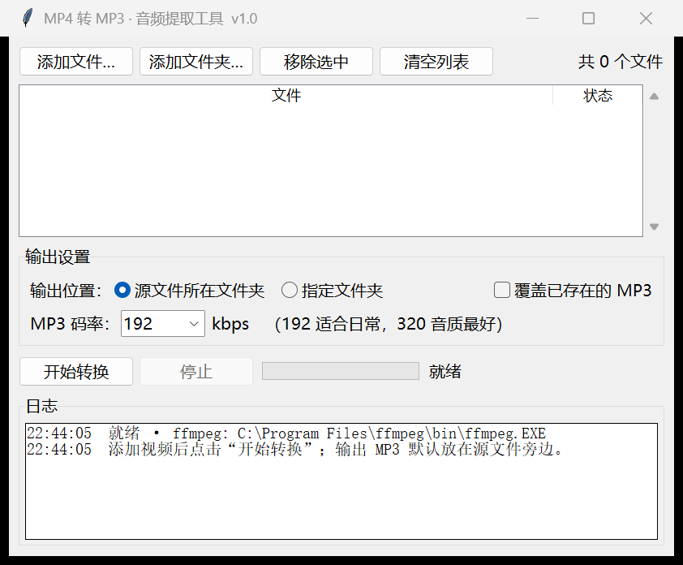

# MP4 → MP3 · 视频音频提取工具

提取 MP4 视频中的音频并保存为 MP3。全部在本机用 ffmpeg 完成，不上传文件。
支持单个文件、批量文件夹、拖放和图形界面。

Extract audio from MP4 videos to MP3 locally with ffmpeg. No uploads.
Single files, folders, drag-and-drop and a GUI are supported.

MP4 動画から音声を抽出して MP3 で保存します。処理はすべてローカルの ffmpeg で行い、
ファイルはアップロードしません。単体ファイル、フォルダ一括、ドラッグ＆ドロップ、
GUI に対応しています。



[中文](#中文) · [English](#english) · [日本語](#日本語)

---

## 中文

### 功能

- 把 MP4（以及 m4v、mov、mkv、avi、webm、flv、wmv、ts 等）中的音频转成 MP3。
- 保留原视频的标题、艺术家等元数据（写入 ID3 标签）。
- 三种用法：图形界面、拖放 BAT、命令行。
- 默认不覆盖已有 MP3；同一批输出重名会自动加 `(2)`、`(3)`。
- 先写 `.part` 临时文件，成功后才改名，失败或中断不会留下半成品。
- 多音轨视频可用 `--track N` 选择音轨；没有音轨的视频会明确报错。

### 文件说明

| 文件 | 用途 |
| --- | --- |
| `mp4_to_mp3.py` | 主程序，同时提供图形界面和命令行 |
| `拖放MP4转MP3.bat` | 把视频拖到它上面即可转换 |
| `gui_preview.png` | 界面预览图 |
| `tests/` | 自动化测试（标准库 unittest） |
| `README.md` | 中文 / English / 日本語说明 |

### 环境要求

- Windows 10 / 11（其他系统只要有 Python 和 ffmpeg 也可用命令行）
- Python 3.8 或更高版本
- ffmpeg，且同一目录下要有 `ffprobe.exe`

检查：

```powershell
ffmpeg -version
ffprobe -version
```

程序会自动在以下位置查找 ffmpeg：

1. 系统 `PATH`
2. 环境变量 `FFMPEG_HOME` 指向的目录或其 `bin` 目录
3. 脚本所在目录及其 `ffmpeg\bin`
4. `C:\Program Files\ffmpeg\bin`
5. `C:\Program Files (x86)\ffmpeg\bin`
6. `C:\ffmpeg\bin`

安装方式：

```powershell
winget install Gyan.FFmpeg
```

或从 <https://www.gyan.dev/ffmpeg/builds/> 下载压缩包，解压后把 `bin` 目录放到
`C:\Program Files\ffmpeg\bin`。

### 用法一：图形界面（推荐）

双击 `mp4_to_mp3.py`，或运行：

```powershell
python mp4_to_mp3.py
```

不想看到命令行窗口时可用 `pythonw`：

```powershell
pythonw mp4_to_mp3.py
```

操作步骤：

1. 点“添加文件…”或“添加文件夹…”（文件夹会递归扫描子文件夹）。
2. 选择输出位置：源文件旁边，或指定文件夹。
3. 选择码率（默认 192 kbps）；需要覆盖旧文件时勾选“覆盖已存在的 MP3”。
4. 点“开始转换”，进度、状态和日志会显示在窗口下方。

### 用法二：拖放

把一个或多个视频文件（也可以直接拖文件夹）拖到 `拖放MP4转MP3.bat` 上。
转换后的 MP3 默认保存在源文件旁边。

### 用法三：命令行

```powershell
# 单个文件，输出到源文件旁边
python mp4_to_mp3.py "D:\视频\旅行.mp4"

# 指定输出文件夹和码率
python mp4_to_mp3.py "D:\视频\旅行.mp4" -o "D:\音频" -b 320

# 批量转换文件夹（含子文件夹）
python mp4_to_mp3.py "D:\视频" -r -o "D:\音频"

# 覆盖已存在的 MP3
python mp4_to_mp3.py "D:\视频" -o "D:\音频" -f

# 使用通配符
python mp4_to_mp3.py *.mp4 -o "D:\音频"

# 选择第二条音轨（从 0 开始）
python mp4_to_mp3.py "D:\视频\双音轨.mp4" --track 1
```

命令行参数：

| 参数 | 说明 |
| --- | --- |
| `inputs` | 视频文件、文件夹或通配符，可以写多个 |
| `-o, --outdir` | 输出文件夹；默认与源文件同目录 |
| `-b, --bitrate` | MP3 码率，32–320 kbps，默认 `192k` |
| `-r, --recursive` | 递归扫描子文件夹 |
| `-f, --force` | 覆盖已经存在的 MP3 |
| `--track N` | 使用第 N 条音轨（从 0 开始），默认 0 |
| `--gui` | 打开图形界面 |
| `--version` | 显示版本 |
| `-h, --help` | 显示帮助 |

### 输出规则

- 输出文件名与视频同名，扩展名换成 `.mp3`。
- 默认输出到源文件所在文件夹；`-o` 可指定统一目录。
- 目标 MP3 已存在时默认**跳过**，加 `-f` 覆盖。
- 同一批文件输出重名时（例如不同子文件夹里有同名视频），自动加 `(2)`、`(3)`。
- 视频没有音频轨道时提示“文件里没有找到音频轨道”，不会生成空文件。
- 转换时先写 `.part` 文件，成功后才改成正式文件名，中断不会留下半成品。
- 视频里的标题、艺术家等元数据会尽量写入 MP3 的 ID3 标签。

### 运行测试

```powershell
python -m unittest discover -s tests -v
```

测试覆盖参数解析、文件收集、输出命名、ffmpeg 探测、单文件转换、跳过/覆盖、
无音轨失败、取消、多音轨、命令行退出码，以及 GUI 的添加、移除、转换、忙碌状态。
GUI 测试需要桌面环境，无桌面时自动跳过。

### 常见问题

**提示找不到 ffmpeg / ffprobe？**

确认 `ffmpeg -version` 和 `ffprobe -version` 能在终端运行。如果不行，重新打开终端让
PATH 生效，或把 ffmpeg 的 `bin` 目录放到 `C:\Program Files\ffmpeg\bin`，或设置
`FFMPEG_HOME`。

**转换失败，提示没有音频轨道？**

该 MP4 本身是无声视频（例如屏幕录制未开麦克风）。可以用播放器确认。

**码率选多少？**

- 128 kbps：语音、播客，文件小
- 192 kbps：默认，音乐和日常视频足够
- 256 / 320 kbps：对音质要求高，文件更大

**支持其他视频格式吗？**

以 MP4 为主，同时兼容 m4v、mov、mkv、avi、webm、flv、wmv、ts 等常见容器。
只要 ffmpeg 能解码出音频即可。

**转换很慢？**

速度主要取决于视频时长和电脑性能；只提取音频通常比视频转码快很多。

---

## English

### Features

- Convert audio from MP4 (and m4v, mov, mkv, avi, webm, flv, wmv, ts, and more) to MP3.
- Copy title, artist and other metadata into ID3 tags when available.
- Three ways to use it: GUI, drag-and-drop BAT, and command line.
- Existing MP3 files are skipped by default; duplicate output names get `(2)`, `(3)`.
- Writes a `.part` file first and renames it only on success, so failures leave no half file.
- Use `--track N` for videos with multiple audio tracks; videos without audio fail clearly.

### Files

| File | Purpose |
| --- | --- |
| `mp4_to_mp3.py` | Main program: GUI and command line |
| `拖放MP4转MP3.bat` | Drag videos onto it to convert |
| `gui_preview.png` | GUI preview |
| `tests/` | Automated tests (standard-library unittest) |
| `README.md` | Chinese / English / Japanese documentation |

### Requirements

- Windows 10 / 11 (the CLI also works on other systems with Python and ffmpeg)
- Python 3.8 or newer
- ffmpeg with `ffprobe.exe` in the same directory

Check:

```powershell
ffmpeg -version
ffprobe -version
```

The program looks for ffmpeg in:

1. System `PATH`
2. `FFMPEG_HOME` (the directory or its `bin` subdirectory)
3. The script directory and its `ffmpeg\bin`
4. `C:\Program Files\ffmpeg\bin`
5. `C:\Program Files (x86)\ffmpeg\bin`
6. `C:\ffmpeg\bin`

Install:

```powershell
winget install Gyan.FFmpeg
```

Or download a build from <https://www.gyan.dev/ffmpeg/builds/>, extract it, and put
the `bin` directory at `C:\Program Files\ffmpeg\bin`.

### Usage 1: GUI (recommended)

Double-click `mp4_to_mp3.py`, or run:

```powershell
python mp4_to_mp3.py
```

To hide the console window, use `pythonw`:

```powershell
pythonw mp4_to_mp3.py
```

Steps:

1. Click “Add files…” or “Add folder…” (folders are scanned recursively).
2. Choose the output location: next to the source, or a specific folder.
3. Pick a bitrate (192 kbps by default). Tick “Overwrite existing MP3” if needed.
4. Click “Start”. Progress, status and logs appear below.

### Usage 2: Drag and drop

Drag one or more videos (or a folder) onto `拖放MP4转MP3.bat`.
MP3 files are written next to the source videos by default.

### Usage 3: Command line

```powershell
# One file, output next to the source
python mp4_to_mp3.py "D:\Videos\trip.mp4"

# Custom output directory and bitrate
python mp4_to_mp3.py "D:\Videos\trip.mp4" -o "D:\Audio" -b 320

# Convert a folder recursively
python mp4_to_mp3.py "D:\Videos" -r -o "D:\Audio"

# Overwrite existing MP3 files
python mp4_to_mp3.py "D:\Videos" -o "D:\Audio" -f

# Use a wildcard
python mp4_to_mp3.py *.mp4 -o "D:\Audio"

# Select the second audio track (zero-based)
python mp4_to_mp3.py "D:\Videos\dual-audio.mp4" --track 1
```

Options:

| Option | Description |
| --- | --- |
| `inputs` | Video files, folders or wildcards; multiple values allowed |
| `-o, --outdir` | Output directory; defaults to the source directory |
| `-b, --bitrate` | MP3 bitrate, 32–320 kbps, default `192k` |
| `-r, --recursive` | Scan subfolders recursively |
| `-f, --force` | Overwrite existing MP3 files |
| `--track N` | Use audio track N (zero-based), default 0 |
| `--gui` | Open the GUI |
| `--version` | Show the version |
| `-h, --help` | Show help |

### Output rules

- Output name matches the video name with a `.mp3` extension.
- Default location is the source folder; use `-o` for a shared directory.
- Existing MP3 files are **skipped** unless `-f` is given.
- Duplicate names in one batch get `(2)`, `(3)`, and so on.
- A video without an audio track reports “文件里没有找到音频轨道” and creates no empty file.
- A `.part` file is used during conversion and renamed only on success.
- Title, artist and other metadata are copied to ID3 tags when possible.

### Tests

```powershell
python -m unittest discover -s tests -v
```

The suite covers argument parsing, input collection, output naming, ffmpeg probing,
single-file conversion, skip/overwrite, missing audio, cancellation, multiple audio
tracks, CLI exit codes, and GUI add/remove/convert/busy states. GUI tests are skipped
when no desktop is available.

### FAQ

**ffmpeg / ffprobe not found?**

Make sure `ffmpeg -version` and `ffprobe -version` work in a terminal. If not, reopen
the terminal so PATH is refreshed, put ffmpeg's `bin` directory at
`C:\Program Files\ffmpeg\bin`, or set `FFMPEG_HOME`.

**Conversion fails with “no audio track”?**

The MP4 is probably silent (for example, a screen recording without a microphone).
Check it in a player.

**Which bitrate should I use?**

- 128 kbps: speech and podcasts, smaller files
- 192 kbps: default, fine for music and everyday videos
- 256 / 320 kbps: higher quality, larger files

**Are other video formats supported?**

MP4 is the main target, and m4v, mov, mkv, avi, webm, flv, wmv, ts and other common
containers work as long as ffmpeg can decode their audio.

**Why is conversion slow?**

Speed depends mainly on duration and hardware. Extracting audio is usually much faster
than transcoding video.

---

## 日本語

### 機能

- MP4（および m4v、mov、mkv、avi、webm、flv、wmv、ts など）の音声を MP3 に変換します。
- タイトル、アーティストなどのメタデータを可能な範囲で ID3 タグに引き継ぎます。
- GUI、ドラッグ＆ドロップ用 BAT、コマンドラインの 3 通りで使えます。
- 既存の MP3 は既定でスキップ。同じバッチ内で名前が重なる場合は `(2)`、`(3)` を付けます。
- 変換中は `.part` ファイルに書き、成功時だけ正式名に変更するため、失敗や中断でも
  中途半端なファイルが残りません。
- 複数音声トラックの動画は `--track N` で選択できます。音声がない動画は明確にエラーになります。

### ファイル構成

| ファイル | 用途 |
| --- | --- |
| `mp4_to_mp3.py` | メインプログラム（GUI とコマンドライン） |
| `拖放MP4转MP3.bat` | 動画をドラッグ＆ドロップして変換 |
| `gui_preview.png` | GUI のプレビュー画像 |
| `tests/` | 自動テスト（標準ライブラリの unittest） |
| `README.md` | 中国語 / 英語 / 日本語の説明 |

### 動作環境

- Windows 10 / 11（Python と ffmpeg があれば他の OS でも CLI は動作します）
- Python 3.8 以上
- ffmpeg（同じディレクトリに `ffprobe.exe` が必要）

確認：

```powershell
ffmpeg -version
ffprobe -version
```

ffmpeg は次の場所を自動で探します：

1. システムの `PATH`
2. 環境変数 `FFMPEG_HOME` のディレクトリ、またはその `bin`
3. スクリプトのあるディレクトリとその `ffmpeg\bin`
4. `C:\Program Files\ffmpeg\bin`
5. `C:\Program Files (x86)\ffmpeg\bin`
6. `C:\ffmpeg\bin`

インストール：

```powershell
winget install Gyan.FFmpeg
```

または <https://www.gyan.dev/ffmpeg/builds/> からビルドをダウンロードして解凍し、
`bin` ディレクトリを `C:\Program Files\ffmpeg\bin` に置きます。

### 使い方 1：GUI（おすすめ）

`mp4_to_mp3.py` をダブルクリックするか、次を実行します：

```powershell
python mp4_to_mp3.py
```

コンソールウィンドウを出したくない場合は `pythonw` を使います：

```powershell
pythonw mp4_to_mp3.py
```

手順：

1. 「添加文件…」（ファイル追加）または「添加文件夹…」（フォルダ追加）をクリック。
   フォルダはサブフォルダまで再帰的に走査します。
2. 出力先を選択：元ファイルの隣、または指定フォルダ。
3. ビットレートを選択（既定 192 kbps）。上書きが必要なら
   「覆盖已存在的 MP3」（既存 MP3 を上書き）にチェック。
4. 「开始转换」（変換開始）をクリック。進捗、状態、ログが下に表示されます。

### 使い方 2：ドラッグ＆ドロップ

1 つ以上の動画（フォルダも可）を `拖放MP4转MP3.bat` にドラッグ＆ドロップします。
MP3 は既定で元動画と同じフォルダに出力されます。

### 使い方 3：コマンドライン

```powershell
# 1 ファイル、元ファイルの隣に出力
python mp4_to_mp3.py "D:\Videos\trip.mp4"

# 出力先とビットレートを指定
python mp4_to_mp3.py "D:\Videos\trip.mp4" -o "D:\Audio" -b 320

# フォルダを再帰的に一括変換
python mp4_to_mp3.py "D:\Videos" -r -o "D:\Audio"

# 既存の MP3 を上書き
python mp4_to_mp3.py "D:\Videos" -o "D:\Audio" -f

# ワイルドカードを使う
python mp4_to_mp3.py *.mp4 -o "D:\Audio"

# 2 番目の音声トラックを選択（0 始まり）
python mp4_to_mp3.py "D:\Videos\dual-audio.mp4" --track 1
```

オプション：

| オプション | 説明 |
| --- | --- |
| `inputs` | 動画ファイル、フォルダ、ワイルドカード。複数指定可 |
| `-o, --outdir` | 出力フォルダ。既定は元ファイルと同じ場所 |
| `-b, --bitrate` | MP3 ビットレート、32–320 kbps、既定 `192k` |
| `-r, --recursive` | サブフォルダを再帰的に走査 |
| `-f, --force` | 既存の MP3 を上書き |
| `--track N` | N 番目の音声トラック（0 始まり）、既定 0 |
| `--gui` | GUI を開く |
| `--version` | バージョンを表示 |
| `-h, --help` | ヘルプを表示 |

### 出力ルール

- 出力名は動画と同じ名前で、拡張子だけ `.mp3` になります。
- 既定の出力先は元ファイルのフォルダです。`-o` で共通のフォルダを指定できます。
- 既存の MP3 は既定で**スキップ**します。`-f` で上書きします。
- 同じバッチ内で出力名が重なる場合（別フォルダに同名動画がある場合など）は
  `(2)`、`(3)` を付けます。
- 音声トラックがない動画は「文件里没有找到音频轨道」と表示し、空ファイルを作りません。
- 変換中は `.part` ファイルを使い、成功時だけ正式名に変更します。
- タイトル、アーティストなどのメタデータは可能な範囲で ID3 タグに書き込みます。

### テスト

```powershell
python -m unittest discover -s tests -v
```

引数解析、入力収集、出力名、ffmpeg の検出、単体変換、スキップ/上書き、音声なしの
失敗、キャンセル、複数音声トラック、CLI の終了コード、GUI の追加/削除/変換/ビジー
状態をテストします。デスクトップがない環境では GUI テストは自動的にスキップされます。

### よくある質問

**ffmpeg / ffprobe が見つからない**

`ffmpeg -version` と `ffprobe -version` がターミナルで動くか確認してください。動かない
場合はターミナルを開き直して PATH を更新するか、ffmpeg の `bin` を
`C:\Program Files\ffmpeg\bin` に置くか、`FFMPEG_HOME` を設定してください。

**「音声トラックがない」と出て変換できない**

その MP4 自体が無音の可能性があります（マイクなしの画面録画など）。プレーヤーで確認してください。

**ビットレートはどれを選ぶ？**

- 128 kbps：音声、ポッドキャスト向け。ファイルが小さい
- 192 kbps：既定。音楽や日常の動画に十分
- 256 / 320 kbps：高音質。ファイルは大きくなる

**他の動画形式は使える？**

MP4 を主対象に、m4v、mov、mkv、avi、webm、flv、wmv、ts などの一般的なコンテナに
対応しています。ffmpeg が音声をデコードできれば変換できます。

**変換が遅い**

時間と PC の性能に依存します。音声だけを取り出す通常の変換は、動画の再エンコードより
ずっと速いことが多いです。
